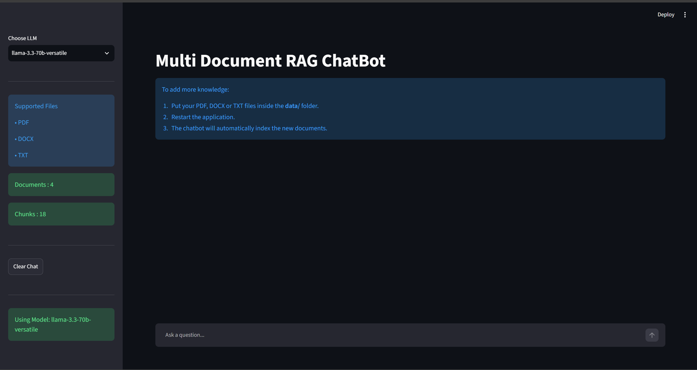

# Multi Document RAG ChatBot

A **Multi-Document Retrieval-Augmented Generation (RAG) Chatbot** built using **Python, LangChain, FAISS, Hugging Face Embeddings, Groq API, and Streamlit**.

This chatbot allows users to ask questions about multiple documents and get answers based on their content.

Instead of manually searching through large documents, users can simply ask questions in natural language, and the chatbot retrieves relevant information from the documents to generate answers.

It uses a structured RAG pipeline to retrieve relevant document content before generating responses using an LLM (Large Language Model).

---

## Application Preview



---

## Features

- **Multi-Document RAG:** Ask questions across multiple documents at the same time.
- **Multiple File Formats:** Supports PDF, DOCX, and TXT files.
- **Semantic Search:** Finds relevant information based on the meaning of your question rather than just matching keywords.
- **FAISS Vector Database:** Stores and searches document embeddings efficiently.
- **Hugging Face Embeddings:** Converts document text into numerical vectors for semantic search.
- **Groq LLM Integration:** Generates answers using large language models through the Groq API.
- **Multiple LLM Selection:** Allows users to choose between supported LLM models.
- **Streamlit Interface:** Provides a simple and interactive chat interface.
- **Retrieved Document Chunks:** Allows users to view the document sections retrieved for their questions.
- **Download Chat History:** Allows users to download their conversation history.

---

## Tech Stack

| Technology | Purpose |
|---|---|
| Python | Main programming language |
| Streamlit | Builds the chatbot user interface |
| LangChain | Connects document loading, splitting, retrieval, and LLM components |
| FAISS | Stores and searches document vectors |
| Hugging Face Embeddings | Converts text into numerical representations |
| all-MiniLM-L6-v2 | Embedding model used for semantic search |
| Groq API | Provides access to LLMs |
| GPT / LLM Models | Generates answers from retrieved information |

---

## Understanding How RAG Works

**RAG stands for Retrieval-Augmented Generation.**

It combines two main processes:

1. **Retrieval:** Finds relevant information from your documents.
2. **Generation:** Uses an LLM to generate an answer based on the retrieved information.

### How This Chatbot Works

**Step 1: Document Loading**

The chatbot reads documents placed inside the `data/` folder.

**Step 2: Text Splitting**

Large documents are divided into smaller pieces called chunks. This makes it easier to retrieve relevant information.

**Step 3: Text Embeddings**

Hugging Face converts each text chunk into numerical vectors called embeddings.

**Step 4: Vector Storage**

FAISS stores these vectors and makes similarity searching possible.

**Step 5: User Question**

The user asks a question through the Streamlit chat interface.

**Step 6: Retrieval**

The chatbot converts the question into an embedding and searches FAISS for the most relevant document chunks.

**Step 7: Answer Generation**

The retrieved chunks are passed to the selected LLM through the Groq API.

The LLM generates an answer using the retrieved information.

### RAG Architecture

```text
                 Documents
                     |
                     v
              Document Loading
                     |
                     v
               Text Splitting
                     |
                     v
          Hugging Face Embeddings
                     |
                     v
              FAISS Vector Store
                     |
                     |
              User Question
                     |
                     v
             Question Embedding
                     |
                     v
               Semantic Search
                     |
                     v
          Relevant Document Chunks
                     |
                     v
                 Groq LLM
                     |
                     v
              Generated Answer
```

---

## Supported File Formats

Place your documents inside the `data/` folder.

Currently supported formats:

| File Format | Extension | Support |
|---|---|---|
| PDF | `.pdf` | Text-based PDFs |
| Word Document | `.docx` | Supported |
| Text File | `.txt` | Supported |

### Example Document Structure

```text
Multi-Document-RAG-ChatBot/
│
├── data/
│   ├── Python.pdf
│   ├── Java.docx
│   ├── C++.txt
│   └── DBMS.pdf
```

You can add multiple documents to the folder.

The chatbot will use the indexed documents as its knowledge source.

---

## Installation and Setup

Follow these steps to run the project on your local machine.

### Step 1: Clone the Repository

Open your terminal or command prompt and execute:

```bash
git clone https://github.com/Cka000/Multi-Document-RAG-ChatBot.git
```

### Step 2: Navigate to the Project Folder

```bash
cd Multi-Document-RAG-ChatBot
```

### Step 3: Create a Virtual Environment (Recommended)

A virtual environment keeps project dependencies separate from other Python projects.

Create one using:

```bash
python -m venv venv
```

Activate the virtual environment.

**Windows:**

```powershell
venv\Scripts\activate
```

**Mac/Linux:**

```bash
source venv/bin/activate
```

### Step 4: Install Dependencies

Install all the required Python packages:

```bash
python -m pip install -r requirements.txt
```

### Step 5: Configure Your Groq API Key

This project uses the Groq API to generate AI responses.

You need your own Groq API key.

**1. Get your API key**

Visit [Groq Console](https://console.groq.com/keys) and create an API key.

**2. Create a `.env` file**

Create a file named `.env` in the project's root directory.

If the repository contains a `.env.example` file, you can copy it and rename the copy to `.env`.

**3. Add your API key**

Open the `.env` file and add:

```env
GROQ_API_KEY=your_actual_groq_api_key
```

Replace `your_actual_groq_api_key` with your actual API key.

**Important:**

- Never share your API key publicly.
- Never upload your `.env` file to GitHub.
- Each developer should configure their own API key.
- Make sure `.env` is included in your `.gitignore` file.

### Step 6: Add Your Documents

Place your PDF, DOCX, and TXT files inside the `data/` folder.

For example:

```text
data/
│
├── Python.pdf
├── Java.docx
├── DBMS.pdf
└── SQL.txt
```

You can use your own study materials, technical documents, notes, or other supported documents.

The chatbot will use these documents as its knowledge source.

### Step 7: Run the Application

Start the Streamlit application:

```bash
python -m streamlit run main.py
```

The chatbot will open in your default web browser.

### Step 8: Start Asking Questions

Once the application is running:

1. Open the chatbot.
2. Select an available LLM.
3. Ask questions related to your documents.
4. View the generated answers.
5. Explore the retrieved document chunks to understand where the information came from.
6. Download your chat history if required.

---

## Customizing the LLM (Large Language Model)

By default, this project uses the Groq API to access LLMs.

The application supports multiple LLM selections, allowing users to experiment with different models.

### How to Change the LLM

1. Visit [Groq Console - Models](https://console.groq.com/docs/models).
2. Explore the available models.
3. Select a model supported by your Groq account.
4. Open `main.py`.
5. Find the LLM model selection or configuration section.
6. Replace or add the model ID according to the existing code structure.

For example:

```python
model = "openai/gpt-oss-120b"
```

You can use another supported model ID instead.

Different LLMs may produce different responses depending on their capabilities.

**Note:**

- Ensure that the selected model is available on your Groq account.
- Check model compatibility with the API features used by this project.
- Using a different LLM provider may require changes to the API client, authentication, and application configuration.

---

## Customizing Your Documents

One of the main advantages of this project is that you can use your own documents as the chatbot's knowledge source.

You do not need to manually enter questions and answers into the Python code.

Instead, you can add your own documents to the `data/` folder.

### How to Add Your Own Documents

1. Open the project directory.
2. Navigate to the `data/` folder.
3. Add your PDF, DOCX, or TXT files.
4. Make sure the files contain readable text.
5. Run or restart the application as required by its indexing implementation.
6. Ask questions about the newly added documents.

### Example

Suppose you want to create a chatbot for learning Python and SQL.

You can add:

```text
data/
│
├── Python_Basics.pdf
├── Python_Advanced.pdf
├── SQL_Notes.docx
├── DBMS_Concepts.pdf
└── Django_Notes.txt
```

Now you can ask questions such as:

- What is a Python decorator?
- Explain SQL joins with examples.
- What is the difference between a list and a tuple?
- Explain Django ORM.

The chatbot retrieves relevant information from the indexed documents and uses it to generate answers.

**Important:**

- Only PDF, DOCX, and TXT files are supported by the current implementation.
- Scanned PDFs require OCR and are not supported.
- Newly added documents may need to be re-indexed before they become searchable.
- Follow the existing document loading and indexing process in `main.py`.

---

## Important Notes

- The chatbot answers questions using information retrieved from the indexed documents.
- If relevant information is not available in the documents, the chatbot should respond accordingly rather than inventing an answer.
- Scanned or image-based PDFs are not supported because they require OCR (Optical Character Recognition).
- Use text-based PDFs for the best results.
- Adding new documents may require re-indexing them before they become available for retrieval.
- The quality of the generated answers depends on document quality, retrieval relevance, and the selected LLM.

---

## Project Structure

```text
Multi-Document-RAG-ChatBot/
│
├── assets/
│   └── screenshot.png
│
├── data/
│   └── Your documents
│
├── .env.example
├── .gitignore
├── main.py
├── requirements.txt
└── README.md
```

*Note: The structure above illustrates the main project files. Your actual repository may contain additional folders or modules.*

---

## Security

- API keys are stored in environment variables.
- The `.env` file should be excluded from Git tracking.
- Never commit private credentials or API keys to the repository.
- Each developer should use their own Groq API key.

---

## Future Improvements

- Support for additional document formats.
- OCR support for scanned PDFs.
- Support for additional LLM providers.
- Improved document management.
- Better source citations for generated answers.
- Advanced retrieval techniques.
- Persistent vector database storage.

---

## Author

**Cka000**

GitHub: https://github.com/Cka000

---

If you find this project useful, consider giving the repository a ⭐ on GitHub!
